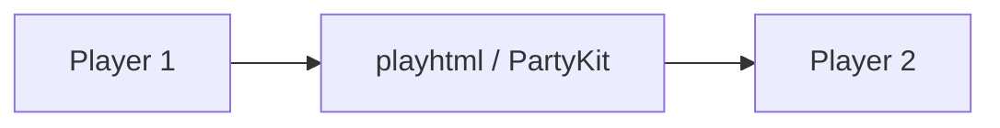
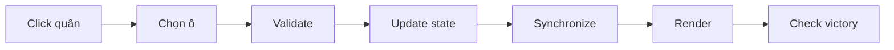

# OTTv2 — Oẳn Tù Tì Online

Game chiến thuật hai người với biến thể bàn cờ cấu hình được, viết bằng TypeScript, Vite, Vitest và playhtml. Mặc định là bàn 9×9; hiện có thêm biến thể 10×10.

## Chạy trên Ubuntu

Cần Node.js 20.19+ và npm:

```bash
npm install
npm run dev
```

Mở địa chỉ Vite in trong Terminal (thường là `http://localhost:5173`). Để chơi trên hai máy cùng mạng, **cả hai máy mở cùng địa chỉ Network** do Vite in ra, ví dụ `http://192.168.1.20:5173`; không dùng `localhost` trên một máy và IP trên máy kia. Không mở trực tiếp `dist/index.html` qua `file://`.

Kiểm tra bằng `npm run typecheck`, `npm run test`, `npm run build`. Vite chỉ phục vụ frontend; playhtml đồng bộ dữ liệu qua hạ tầng PartyKit theo [tài liệu chính thức](https://playhtml.fun/docs/).

## Phòng chơi

Trang chủ hiển thị danh sách phòng đang có. Nhập tên, chọn **Tạo phòng mới** để nhận mã ngẫu nhiên; chia sẻ mã hoặc link cho người thứ hai. Có thể nhập mã hay bấm **Vào phòng** từ danh sách. Hai người nhấn **Tôi đã sẵn sàng** để bắt đầu. Người thứ ba chỉ xem.

Mỗi phòng có kênh game riêng trong playhtml; danh sách phòng dùng một kênh chung. Khi trận đã kết thúc và số người chơi đang online giảm xuống dưới hai, phòng bị xóa khỏi danh sách và không thể tham gia bằng mã cũ. Nếu tất cả đóng tab, phòng sẽ được dọn khi có người khác mở trang. Nút **Rời phòng** giải phóng vị trí ngay. Dữ liệu kênh game cũ có thể vẫn còn trong hạ tầng playhtml; mã phòng đã xóa không còn trỏ tới kênh đó.

Mỗi lần chạy `npm run dev` dùng một phiên lobby mới; các máy phải dùng cùng một Vite server để nhìn thấy cùng danh sách. Bản production dùng phiên được tạo lúc `npm run build`.

## Luật

Mỗi bên có 3 ✊, 3 ✋, 3 ✌️. Player 1 ở a2:c4, Player 2 ở g6:i8. Đi đúng một ô theo tám hướng; ✊ ăn ✌️, ✌️ ăn ✋, ✋ ăn ✊. Cùng loại chặn nhau. Loại hết một loại quân đối phương hoặc tới i9 (Player 1), a1 (Player 2) để thắng. Không còn nước đi là hòa. Trận đầu Player 1 đi trước; chơi lại đổi người đi trước. Khi tạo phòng có thể chọn biến thể bàn 9×9 hoặc 10×10.





## Kiến trúc và triển khai

`src/game/variants/types.ts` định nghĩa cấu trúc biến thể; `src/game/variants/classic.ts` và `src/game/variants/large-board.ts` chứa cấu hình bàn, đội hình, cách di chuyển, quân cờ và điều kiện thắng. Đăng ký biến thể mới trong `src/game/variants/index.ts`. `src/game/engine.ts` áp dụng cấu hình đó; trạng thái trận lưu mã và phiên bản biến thể để đồng bộ với người chơi/replay. Khi thêm biến thể, bổ sung test trong `tests/engine.test.ts`.

`src/multiplayer/room.ts` quản lý danh sách phòng, kênh game và presence; `src/main.ts` dựng giao diện theo biến thể của phòng. Bot Arena backend hiện vẫn dùng engine riêng với luật 9×9. Build bằng `npm run build`, đưa `dist/` lên Vercel hoặc Netlify. Muốn chơi qua Internet, cả hai dùng cùng URL HTTPS sau khi triển khai.

## Kiểm thử multiplayer

Mở hai browser profile hoặc hai máy cùng địa chỉ Network. Tạo phòng, tham gia bằng mã, kiểm tra danh sách, trạng thái sẵn sàng, lượt, ăn quân, kết quả, chơi lại và rời phòng. Sau khi một người rời trận đã kết thúc, kiểm tra phòng biến mất và mã cũ không tham gia được. Những bước thủ công này chưa được đánh dấu đã kiểm thử nếu chưa chạy trên thiết bị thật.

## Hạn chế

playhtml không cung cấp transaction hay quyền điều khiển game trên server. Luật và phiên bản lượt được kiểm tra ở client, nên client bị sửa hoặc thao tác đồng thời vẫn có thể gây sai lệch. Presence có thể báo offline trễ. Để chống gian lận và bảo đảm xử lý đồng thời, hướng phát triển là bổ sung server authoritative. Danh sách và các kênh game dùng chung một kết nối playhtml, nên chưa phù hợp với số lượng phòng rất lớn.

# BOT ARENA – HƯỚNG DẪN SỬ DỤNG

## 1. Giới thiệu

Bot Arena là chế độ mở rộng của game OTTv2, cho phép người chơi viết bot bằng JavaScript, Python hoặc C để hai bot tự động thi đấu với nhau.

Các chức năng chính:

- Nộp bot JavaScript, Python hoặc C.
- Kiểm tra giao diện bot và kích thước mã nguồn.
- Chạy script trong môi trường Docker Sandbox.
- Tổ chức trận đấu Bot vs Bot.
- Hiển thị người thắng, lịch sử nước đi và phát lại trận đấu trên bàn cờ 9×9.
- Lưu log kiểm tra script và trận đấu.

## 2. Cài đặt và khởi động

Yêu cầu: Node.js, npm và Docker Desktop.

Mở Terminal trong thư mục dự án, chạy:

```bash
npm install
docker pull node:22-alpine
docker pull python:3.13-alpine
docker pull gcc:14
npm run dev:all
```

Truy cập địa chỉ Vite hiển thị, thường là http://localhost:5173.

Lưu ý: Docker Desktop phải đang hoạt động.

## 3. Cách sử dụng Bot Arena

1. Mở game và chọn chế độ **Bot Arena**.
2. Nhập tên bot, chọn ngôn ngữ, sau đó tải file `.js`, `.py`, `.c` hoặc dán mã nguồn.
3. Gửi script để hệ thống kiểm tra.
4. Nếu kết quả là `PASSED`, bot có thể được chọn để thi đấu.
5. Chọn Bot A và Bot B, sau đó nhấn **Bắt đầu trận đấu**.
6. Xem kết quả thắng/thua và sử dụng các nút điều khiển để phát lại trận đấu.

## 4. Ví dụ script bot

Mỗi lượt bot nhận một snapshot JSON qua giao thức của ngôn ngữ đó. Snapshot có `player`, `turn`, `version`, `pieces` và `legalMoves`. Kết quả cần chứa `pieceId` và tọa độ đích `to.row`, `to.col`; server kiểm tra nước đi bằng engine trước khi áp dụng.

API bot, snapshot mẫu và các file bot tối giản có thể tải lên nằm trong `server/examples/bots/bot-api.md`, `server/examples/bots/snapshot.example.json`, `server/examples/bots/api.js`, `server/examples/bots/api.py` và `server/examples/bots/api.c`. Bot chiến thuật mẫu nằm trong các file `tactical.*`; chúng ưu tiên ăn quân hợp lệ, sau đó chọn nước tiến gần mục tiêu. Các bot chiến thuật cũng đã được đăng ký trong dữ liệu Bot Arena của môi trường hiện tại.

```javascript
export function getMove(state) {
  const moves = state.legalMoves;

  if (moves.length === 0) return null;

  return moves[0];
}
```

Bot JavaScript phải export `getMove(state)`. Bot Python định nghĩa `get_move(state)`:

```python
def get_move(state):
    if not state["legalMoves"]:
        return None
    return state["legalMoves"][0]
```

Bot C đọc snapshot JSON từ stdin và in một object quyết định JSON ra stdout. Ví dụ sau chọn nước hợp lệ đầu tiên từ JSON snapshot chuẩn của Bot Arena:

```c
#include <stdio.h>
#include <string.h>

int main(void) {
    char input[131072], pieceId[64];
    int row, col;
    size_t length = fread(input, 1, sizeof(input) - 1, stdin);
    input[length] = '\0';

    const char *moves = strstr(input, "\"legalMoves\":[");
    if (!moves) return 1;
    moves += strlen("\"legalMoves\":[");
    const char *piece = strstr(moves, "\"pieceId\":\"");
    const char *to = strstr(moves, "\"to\":{\"row\":");
    if (!piece || !to ||
        sscanf(piece, "\"pieceId\":\"%63[^\"]\"", pieceId) != 1 ||
        sscanf(to, "\"to\":{\"row\":%d,\"col\":%d}", &row, &col) != 2)
        return 1;

    printf("{\"pieceId\":\"%s\",\"to\":{\"row\":%d,\"col\":%d}}\n",
           pieceId, row, col);
    return 0;
}
```

Python/C entry-point and size checks do not guarantee valid syntax; compilation/execution errors forfeit that bot's turn. C submissions are limited to 16 KiB because their source is passed into the isolated compiler container.

## 5. Kiểm tra bảo mật

Hệ thống phân tích script trước khi cho phép sử dụng.

- `PASSED`: Vượt qua các bước kiểm tra.
- `REJECTED`: Script không hợp lệ hoặc chứa thao tác bị hạn chế.
- `FORFEIT`: Bot bị xử thua khi thi đấu do lỗi thực thi hoặc nước đi không hợp lệ.

Lưu ý: Kiểm tra tĩnh không đảm bảo phát hiện mọi mã độc. Script được thực thi trong môi trường Docker cách ly.

## 6. Lỗi thường gặp

- Không mở được game: Kiểm tra `npm run dev:all`.
- Không nộp được script: Kiểm tra backend ở cổng 4174.
- Bot không thi đấu được: Kiểm tra Docker Desktop.
- Script bị từ chối: Xem thông báo lỗi và sửa lại mã nguồn.

## 7. Hạn chế hiện tại

- JavaScript chạy bằng Node.js; Python chạy bằng Python; C được biên dịch bằng GCC trong các container riêng, cách ly.
- Mỗi ngôn ngữ cần image Docker tương ứng: `node:22-alpine`, `python:3.13-alpine`, `gcc:14`.
- Giới hạn source JavaScript/Python là 64 KiB; C là 16 KiB. Mỗi lượt chịu giới hạn thời gian, bộ nhớ, CPU, output và không có mạng.
- Trận đấu được xử lý trước khi hiển thị replay.
- Hệ thống hiện phù hợp để thử nghiệm cục bộ, chưa sẵn sàng triển khai công khai.
